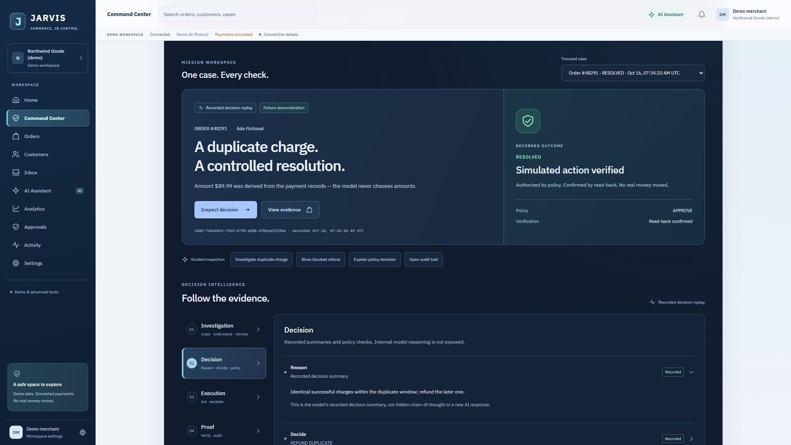
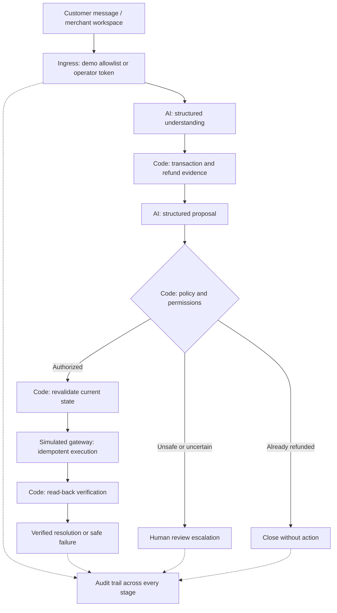

<div align="center">

**JARVIS AUTOMATIONS · COMMERCE, IN CONTROL**

# A duplicate charge. A controlled resolution.

**AI proposes. Policy decides. Every refund is verified.**

Investigate payment exceptions, authorize a simulated refund from transaction evidence,
and verify the result—or hand the case to a person with a complete audit trail.

[**Explore the public demo →**](https://jarvis-actiii-preview.vercel.app/#/command-center) · [Watch the 3:30 film](https://storage.googleapis.com/lablab-video-submissions/submissions/jpcwip3viee0s3f1hkwb0vgv/lp1nzpneomsafp3lv6rjp220/video/video_mth4q7sf53kfdjj6qlg30myk.mp4) · [Read the deck](docs/submission/deck/jarvis-deck.pdf) · [Inspect the evidence](docs/submission/EVIDENCE_SUMMARY.md)

**Public demo: fixture AI · synthetic data · simulated payments · no real money moves**

</div>



*Actual product capture, 16 Oct 2026. Recorded fixture demonstration, not a live AMD inference session.*

## Proof before promises

Historical hosted-model evaluation: **14 Oct 2026 · DeepSeek-V4-Flash · run `tf-1`**.

| **26 / 30** | **0 / 30** | **20 / 20** | **17 / 17** |
|:---:|:---:|:---:|:---:|
| Exact benchmark outcomes | Unsafe autonomous actions observed | Correct escalations by benchmark definition | Real-model demo checks |

Sources: [raw benchmark](evals/results/duplicate-charge-eval.v1.vllm-deepseek-v4-flash-tf-1.json) · [demo checks](evals/results/demo-evidence-live-20261014T201902Z.json) · [definitions and provenance](docs/AMD_EVIDENCE.md).

These are bounded synthetic evaluations, not production results or a safety guarantee. Two cases (`DC-E02`, `DC-E03`) use scripted decision outputs. The four exact-outcome misses include a timeout, two conservative escalations and invalid decision output. The escalation metric counts a safe `FAILED` case as correct; it does not mean every case ended in `ESCALATED`. Only **7/10** ground-truth autonomous cases resolved autonomously. No ROI, business impact or plain-LLM comparison has been measured.

The separate [fixture benchmark](evals/results/duplicate-charge-eval.v1.json) records **29/30 exact outcomes and zero unsafe actions**. Fixture figures shown in the app are distinct from the hosted-model results above.

## Three cases. Three accountable outcomes.

| Scenario | Evidence and control | Outcome |
|---|---|---|
| **#48291 · duplicate $89.99 charge** | Two matching successful charges. Policy derives 8,999 minor units from records, revalidates, then permits an idempotent simulated refund. Read-back confirms it. | **RESOLVED · verified** |
| **#48294 · suspicious $5,000 request** | Claim contradicts the $89.99 records and contains instruction-like text. Policy denies it; execution is never reached. | **ESCALATED · no refund** |
| **#48293 · already refunded** | Records show the duplicate was already refunded. No additional action is authorized. | **CLOSED_NO_ACTION · no second refund** |

[Trace inputs, decisions, audit events and historical AMD outcomes](docs/submission/HERO_EVIDENCE_MAP.md). The public demo also includes a conflicting-amount scenario; canonical requests run in fresh synthetic worlds.


*Actual fixture UI capture. [Public-deployment scenario evidence](evals/results/hero-evidence-vercel-prod-20261016.json) records the outcomes.*

## The model proposes; code holds authority



The model cannot choose refund amounts, authorize payments, execute actions or mark them verified. Deterministic TypeScript handles money arithmetic, permissions, policy, idempotency and state transitions. Proposals are schema-validated and rechecked against records before execution.

[Architecture and source map](docs/submission/ARCHITECTURE_SUMMARY.md) · [case engine](apps/api/src/case-engine.ts) · [policy engine](apps/api/src/policy-engine.ts) · [safety invariant tests](apps/api/test/safety-invariants.test.ts)

## AMD integration, with provenance

JARVIS used **AMD-hosted OpenAI-compatible inference** for understanding and decision proposals in the recorded 14 Oct run. Configured model: `DeepSeek-V4-Flash`; observed smoke-test model: `self-dploy/DeepSeek-V4-Flash`.

| Boundary | What the evidence supports |
|---|---|
| Hosted endpoint | `https://developer.amd.com.cn/radeon/api/v1`, from AMD documentation supplied by the owner; [completion receipt](evals/results/amd-live-001.json) and [startup gate](evals/results/live-gate-20261014T201902Z.json) are committed |
| Token Factory naming | Equivalence to the hackathon Token Factory portal is **not independently confirmed** |
| Hardware | Remote hosted API; no self-hosted AMD GPU, GPU model, ROCm deployment or training demonstrated |
| Runtime | Adapter mode is named `vllm`; that name does not establish the provider's serving stack. Startup requires a listed model and valid probes; no fixture fallback |
| Public deployment | Fixture-only Vercel demo; live inference belongs on a private long-running host with server-side credentials |
| Optional Gemma | Smoke/startup evidence exists, but no end-to-end cases or benchmark. Last recorded startup failed closed because Gemma was no longer listed |

The benchmark records commit `55be4ab`, a dirty working tree, dataset SHA-256, prompt hashes and scripted cases. [AMD evidence](docs/AMD_EVIDENCE.md) explains clock differences, failures and reproduction. Current code also rejects mismatched provider-reported model IDs; that later guard was **not exercised in the historical live run**.

## Run it locally

Requires **Node.js 24 or later**. From the repository root:

```bash
npm ci
npm ci --prefix apps/web
npm run api:start
```

In a second terminal:

```bash
npm run web:dev
```

Open [the local workspace](http://127.0.0.1:43123/#/command-center). The API defaults to port 3000 and fixture AI; no model key is required. Use the demo store or canonical scenarios to create cases. Free-text requests require a server-side operator token.

Verify locally, with the API running:

```bash
npm run demo:verify
npm run api:typecheck
npm test
npm run web:build
npm run api:bench:ci
```

These are reproduction commands, not a claim about current CI status. For hosted inference, follow the [owner runbook](docs/OWNER_RUNBOOK.md), [AMD reproduction steps](docs/AMD_EVIDENCE.md) and [environment template](apps/api/.env.example). Live calls require credentials and can incur provider charges.

## Explore the implementation and receipts

| Start here | What you can inspect |
|---|---|
| [Evidence summary](docs/submission/EVIDENCE_SUMMARY.md) | Historical checks, dates, verified and unverified claims |
| [Pinned dataset](data/cases/duplicate-charge-eval.v1.json) · [evaluator](apps/api/eval/run-benchmark.ts) | Ground truth and metric definitions, including safe failures |
| [Hero evidence map](docs/submission/HERO_EVIDENCE_MAP.md) | Three outcomes linked to raw audit artifacts |
| [Implementation status](docs/IMPLEMENTATION_STATUS.md) | Implemented capabilities and outstanding work |
| [Business evidence](docs/BUSINESS_EVIDENCE.md) | Measured technical results versus assumption-labelled estimates |
| [Demo script](docs/DEMO_SCRIPT.md) · [screenshot gallery](docs/screenshots/) | Merchant workflow and earlier fixture UI captures |
| [Submission and film](https://lablab.ai/submissions/lp1nzpneomsafp3lv6rjp220) · [corrected deck](docs/submission/deck/jarvis-deck.pdf) | Public submission and repository presentation materials |

The workspace includes orders, customers, inbox, approvals, audit and analytics. Recorded cases are stored in this browser (newest 50); sample analytics are separately labelled. Duplicate-charge refunds are the working automation. Other catalog entries are previews. See the [build contract](docs/JARVIS_ACT_III_BUILD_CONTRACT.md) and owner runbook for operational boundaries.

## Limits that matter

- **Synthetic data and simulated gateway:** no real payments, external store connection or production customer deployment demonstrated.
- **Human review is review-only:** escalation does not implement a complete approval-to-payment workflow.
- **Finite evaluation:** one historical hosted-model benchmark, with conservative misses and two scripted cases; zero observed unsafe actions does not prove general safety.
- **In-memory controls:** limits apply per process; serverless limits are per instance and budgets reset on restart. Serverless deployments refuse live-model cases.
- **Shared operator token:** no per-user identity or token-use audit. Run the Node server behind a trusted TLS proxy; see the runbook.
- **Provider availability changes:** historical receipts do not promise present availability. Gemma cases, self-hosted GPUs, Evolus integration and measured commercial impact remain unproven.

---

<div align="center">

**Inspect the evidence. Follow the decision. Verify the action.**

[Open JARVIS →](https://jarvis-actiii-preview.vercel.app/#/command-center)

</div>
