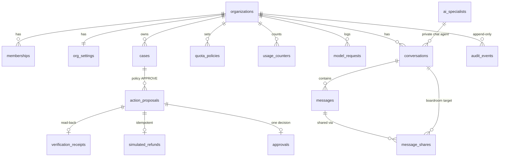

# JARVIS cloud backend: audit, design, access control and risks

Branch: `feature/actiii-grand-championship`. Status: **built and unit-tested locally; not applied to any Supabase project and not deployed.** The published competition site is unchanged.

## 1. Current storage audit (what exists today)

| Data | Where it lives now | Durable? | Shared between users? |
|---|---|---|---|
| Synthetic customers, orders, charges, refunds | In memory, rebuilt for every request (`apps/api/src/fixtures.ts`, `ingress.ts` `freshWorld`) | No | No |
| Cases, audit trail | Returned in the HTTP response; not stored by the server | No | No |
| Judge/case history in the browser | `localStorage` key in `apps/web/src/lib/session-store.ts` | Per browser only | No |
| AI Team chats | `localStorage` key `jarvis.team.v1` (`apps/web/src/team/conversations.ts`), unencrypted, one user | Per browser only | No |
| Workspace setup | `localStorage` (`App.tsx`) | Per browser only | No |
| Rate limits, team request/spend counters | Process memory (`limits.ts`, `team/openrouter.ts`) | Reset on restart | No |
| Evaluation and live-run evidence | JSON files in `evals/results/`, committed | Yes (git) | Read-only |
| Provider keys | Process environment of the owner's local server only | No | No |

**There is no database in the shipped product.** Nothing survives a server restart except committed evidence files.

## 2. Technology choice

- **PostgreSQL on Supabase** for the multi-user cloud product. Row-level security (RLS) gives tenant isolation inside the database. Supabase Auth issues the JWTs that RLS checks through `auth.uid()`. Edge Function secrets hold provider keys outside the database.
- **SQLite was considered and not used.** It has no row-level security and no roles, so isolation would depend entirely on application code, and it does not fit a hosted multi-tenant deployment. Local development uses the same Postgres migration against a Supabase project (or a local Supabase stack), so there is one schema and one set of policies.
- **Supabase Edge Functions (Deno) for the AI Team gateway.** The team modules (`apps/web/src/team/*`, `apps/api/src/team/openrouter.ts`) use only `fetch`, `AbortSignal`, `TextEncoder` and zod, so they run unchanged on Deno. `scripts/sync-edge-shared.mjs` copies them byte for byte into `supabase/functions/_shared/jarvis/`, and a test fails if the copies drift.
- **The core refund engine stays on Node.** It uses `node:crypto` and `Buffer` (`case-engine.ts`, `ingress.ts`, `openai-compatible-client.ts`), and it is the competition-critical path. Porting it now would risk the policy behaviour, so it was not moved. A cloud AMD route is designed (Section 6) but **disabled**: the only AMD key was exposed earlier.

## 3. Architecture

```
Browser (Vercel, public Judge Mode: fixtures only, no keys, no database writes)
   │  Supabase Auth session (JWT)                    ▲ results, provenance labels
   ▼                                                 │
Edge Function team-gateway ── CORS allowlist, JWT verify, strict body, role check under RLS
   │   ├─ reserve_model_request()  (SQL, as the caller: atomic daily quota)
   │   ├─ OpenRouter (free model only, key from function secrets, no retries, ≤6 calls per operation)
   │   ├─ figure check + schema validation (same code as the local server)
   │   └─ complete_model_request(), AI messages, audit (service role, server-side only)
   ▼
Postgres (RLS on every table)
   organizations · memberships · conversations/messages/message_shares · model_requests/usage_counters
   cases · action_proposals · approvals · simulated_refunds · verification_receipts · audit_events
   │
   └─ decide_proposal() / execute_approved_refund(): human approval, idempotent SIMULATED refund,
      read-back receipt, audit, all in one transaction
```

The model proposes; it never writes money state. A refund proposal exists only when the deterministic policy engine returned `APPROVE` (`record_case`). The amount comes from the policy's own action record, never from model text. A human owner or operator of that proposal's org approves it once. Execution is simulated, idempotent on the proposal's idempotency key, and verified by reading it back.

## 4. Schema

`supabase/migrations/20261017200000_jarvis_core.sql`, rollback in `supabase/rollback/`.



Integrity rules:
- Composite foreign keys `(id, org_id)` stop a child row from pointing at a parent in another org.
- Money is `bigint` minor units with `> 0` checks.
- Idempotency keys are unique per org.
- There is one approval, one refund and one receipt per proposal.
- Usage is checked as `used <= max_requests`.

## 5. Access-control matrix

Read means rows returned under RLS. "Fn" means only through a SQL function that re-checks the caller.

| Resource | anon | viewer | operator | owner | platform admin | service role (gateway) | AI model |
|---|---|---|---|---|---|---|---|
| Organization, members | — | read | read | read; set roles (Fn, never own) | — | all | — |
| Own private chat | — | read/write/delete | read/write/delete | read/write/delete | — | write AI replies | content only |
| Someone else's private chat | — | — | — | — | — | — | — |
| Boardroom | — | read | read, post | read, post | — | write AI messages | content only |
| Share own private message to boardroom | — | yes | yes | yes | — | — | — |
| Model quota | — | read | reserve (Fn) | reserve (Fn) | — | complete (Fn) | — |
| Model request history | — | own | own | whole org | — | all | — |
| Cases, proposals, receipts | — | read | read | read | — | record (Fn) | — |
| Approve / execute refund | — | — | Fn | Fn | — | — | **never** |
| Audit events | — | — | read | read | — | append | — |
| Security events, platform admins | — | — | — | — | via health Fn | append | — |
| Provider keys | — | — | — | — | configured yes/no | read (function secrets) | — |

## 6. AI routing

| Route | Provider and model | Who may call | Data that leaves the backend | Limits | Status |
|---|---|---|---|---|---|
| Team specialists | OpenRouter, one `:free` model from `JARVIS_TEAM_MODEL` | Org owner/operator, through the gateway | Scoped synthetic metrics for that role, the request, explicitly shared notes | ≤6 calls per operation, daily org quota (default 0), 900 output tokens, 60 s, no retries, any cost stops it | Built; needs `JARVIS_TEAM_LIVE_ENABLED=1` |
| Core refund understanding and proposal | AMD endpoint, `DeepSeek-V4-Flash` | Owner's local server only | Synthetic customer message and order evidence | Daily call budget, 20 rpm, served-model check, policy decides | Local only; no cloud route (exposed key) |

There is no fallback between providers in either direction. The browser and model text cannot change the endpoint, the model or the tools: the base URL is checked against an allowlist, the model is a server secret, and the tools are a fixed read-only list per role.

## 7. One-time private credential setup

This happens only after a project exists, the migration and tests have passed there, and the functions are deployed.

1. Open the project's **Edge Functions → Secrets** page in the Supabase dashboard. The exact link is sent once the project exists.
2. Add the following secrets:

   | Secret | Value |
   |---|---|
   | `JARVIS_TEAM_PROVIDER` | `openrouter` |
   | `JARVIS_TEAM_MODEL` | `nvidia/nemotron-3-super-120b-a12b:free`, or another `:free` id |
   | `JARVIS_TEAM_API_KEY` | your OpenRouter key, pasted only into that page |
   | `JARVIS_ALLOWED_ORIGINS` | the site origin(s), comma-separated |

   The AMD key (`JARVIS_MODEL_API_KEY`) is **not needed**: no cloud route uses it.
3. Save. Do not send any key to Claude or put it anywhere else.
4. A platform admin calls `admin-health`. It answers configured yes/no and whether the model is listed at zero price; it never returns a value.
5. Live calls stay off until the owner separately adds `JARVIS_TEAM_LIVE_ENABLED=1` and sets the org's daily OpenRouter quota above 0.

Supabase **Vault** is not used for these keys: Vault is for secrets the database itself needs, and these keys are only needed by the functions.

## 8. Security risk register (severity-ranked)

| # | Severity | Risk | Current control | Remaining gap |
|---|---|---|---|---|
| 1 | High | Exposed AMD key | No cloud route uses it; local owner-run only, loopback server | Cannot rotate; anyone holding it can use its quota |
| 2 | High | Service-role key bypasses RLS | Used only inside `supabase-deps.ts`; every tenant check uses the caller's JWT; server-only functions re-check membership | A bug in gateway code could still misuse it; needs code review on every change |
| 3 | Medium | Prompt injection through business data or shared notes | Data passed as JSON values; no tool can act; schema, role, tool and figure checks | A model can still write misleading prose that passes the number check |
| 4 | Medium | Fabricated figures close to real ones | Figure check rejects numbers more than max(0.051, 0.5%) from a computed value | A value within 0.5% of a real figure is accepted |
| 5 | Medium | Quota exhaustion and cost | Atomic DB quota (default 0), free-only, cost stop, provider-side $0 key limit | Supabase function invocation limits are separate; no IP rate limit on the gateway |
| 6 | Medium | Denied-access events lost | Gateway logs denials to `security_events` after catching them | Denials inside SQL functions roll back their own writes, so only gateway-level denials are recorded |
| 7 | Medium | Audit tampering by an admin | Append-only triggers for every role | The database owner can drop a trigger; not tamper-proof storage |
| 8 | Low | XSS from model text | React renders text only; no `dangerouslySetInnerHTML` | No CSP header on the Node dev server |
| 9 | Low | CSRF | Bearer JWT in the header, not cookies; CORS allowlist | — |
| 10 | Low | SSRF | Base URL allowlist (OpenRouter or loopback in tests) | — |
| 11 | Low | SQL injection | Supabase client parameterises; SQL functions take typed arguments; no dynamic SQL | — |
| 12 | Info | Process-local limits on the local server | One request at a time, request cap | Reset on restart; documented, not claimed as global |

No compliance certification or absence of vulnerabilities is claimed.

## 9. Tests

| Suite | What it proves | Where it runs |
|---|---|---|
| `apps/api/test/cloud-gateway.test.ts` (8) | Origin, JWT, body, role, disabled-live, misconfiguration, quota-before-dispatch, withheld figures, no key in responses, admin health booleans, edge copies in sync | Node, against fakes and a loopback mock |
| `apps/api/test/team-openrouter.test.ts` (23) | Free-only, request cap, cost stop, 429/402 stop, cancellation, staged runs, dispatch hooks | Node |
| `apps/web/test/figure-check.test.ts` (19) | Number formats and withholding | Node |
| `supabase/tests/security_test.sql` | Cross-user and cross-org reads, anon, role escalation, AI/viewer approval, forged and replayed approvals, execution before approval, duplicate execution, quota exhaustion, model-history privacy, audit tampering, export and deletion | **Needs a Postgres with the migration applied; not yet run** |

Not covered yet:
- true concurrent sessions against Postgres (the single-statement reservation and the unique constraints are the controls);
- a backup-and-restore drill;
- the Deno runtime itself (the gateway logic is tested under Node, but the Deno wiring has not run).

## 10. Deployment (when approved)

1. Create or choose the Supabase project. This needs the owner's approval.
2. Apply the migration, then run `supabase/tests/security_test.sql`. It must end with `JARVIS_DB_TESTS_PASSED`.
3. Run `node scripts/sync-edge-shared.mjs`, then deploy `team-gateway` and `admin-health` with JWT verification on.
4. Do the one-time secret setup (Section 7) and the health check.
5. To enable live use, set the quota and `JARVIS_TEAM_LIVE_ENABLED=1`. This is a separate owner decision.

**Backup:** Supabase daily backups (plan-dependent) plus `pg_dump` of the `public` schema before every migration. **Restore drill:** restore into a scratch project and rerun the security test.

**Rollback:** `supabase/rollback/20261017200000_jarvis_core.down.sql`. It destroys all data, so take a backup first.

**Retention:**
- `purge_expired_chats()` deletes chat messages older than the org's `chat_retention_days` (default 90).
- Audit rows are kept for `audit_retention_days` (default 7 years). No purge job is shipped yet.
- People can export their data (`export_my_data`) and delete their private chats.
